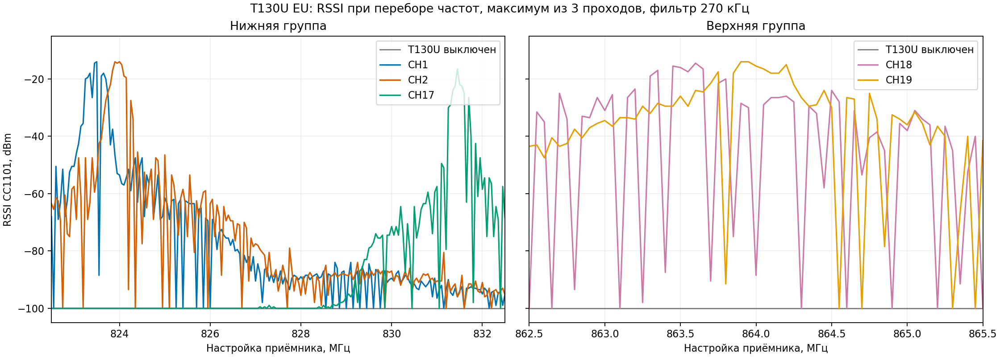
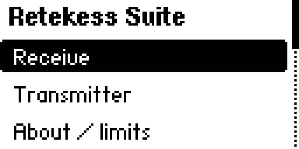
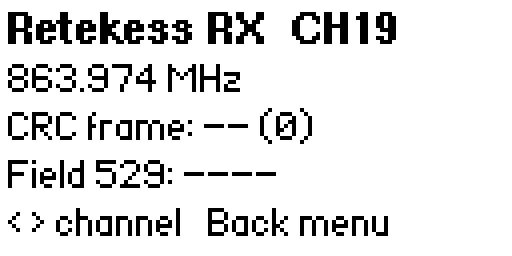

# Retekess T130U / T131U radio research for Flipper Zero

Independent investigation of one EU T130U/T131U kit. This public repository contains a Flipper Zero app, reverse-engineering source code, measurements, and diagrams. **Recordings containing the owner's voice and all raw capture archives are excluded.** [Русская версия](README.ru.md).

## Findings

- The working Flipper receive profile is about 250 kbit/s GFSK. Measured centers: CH1 823.475 MHz, CH17 831.475 MHz, CH18 863.475 MHz, CH19 863.975 MHz; CHS service band 864.475 MHz.
- Observed frame: 32-bit channel marker, one fixed bit, 62 G.711 A-law bytes, 16-bit service field, CRC-16/AUG-CCITT over bits 33–544. [Frame diagram](figures/frame_structure.svg) · [protocol notes](docs/PROTOCOL.md).
- On the owner's T131U, captured-frame and generated-frame experiments previously confirmed CHS targets CH1 `0x1101`, CH18 `0x1112`, CH19 `0x1113`, plus All Off `0x7777`. Short CH19 audio was reproduced.
- The service-field pattern suggests `0x1100 | channel` for CH1–CH19. The app offers all 19 targets; **CH2–CH17 are unverified candidates**. The public build uses newly synthesized A-law silence in control frames. Those privacy-safe frames still need receiver testing.

## Flipper application

Download [Retekess Suite `.fap`](bin/retekess_suite.fap) or build [`app/`](app/) using `ufbt` with Flipper API 87.1. Copy it to `/ext/apps/Sub-GHz/`. This build targets Momentum `mntm-012`; it does not require firmware flashing.

- **Receive**: CRC monitor on CH1, CH17–CH19 or CHS; event CSV; short raw capture and A-law extraction; experimental speaker playback.
- **Transmitter**: candidate CHS target selector CH1–CH19, All Off, and pre-encoded CH19 audio file. Menu labels mark previously tested targets as *known* and others as *test*.
- Files are stored under `/ext/retekess_probe/` on the Flipper.

The app builds and its UI/capture workflow ran on Flipper. Its newly synthesized control frames, expanded channel selector, and speaker output have **not yet been validated end-to-end** on T131U. The earlier results above used private capture-derived frames. For audio encoding without any captured template: `python3 research/retekess_audio_encoder.py input.wav --output custom_alaw_radio.bin` (`ffmpeg` required). The file picker expects this encoded radio `.bin`, not a WAV.

 

## Research source and limits

[`research/`](research/) contains the original experiment programs and analysis scripts. Payload headers and raw captures have been removed for privacy; some historical experimental FAPs therefore need fresh captures to rebuild. The integrated app in `app/` is self-contained. The protocol is **not fully decoded**: pairing/group ID, all physical channel parameters, exact packet boundaries, long-track streaming, and distinct MIC/AUX/Bluetooth commands remain open. Measurements are from one EU kit and may differ across revisions.

Use radio transmission only on your own equipment and where you are authorized to operate. This independent project is not affiliated with Retekess or Flipper Devices. Code and documentation: MIT license.
