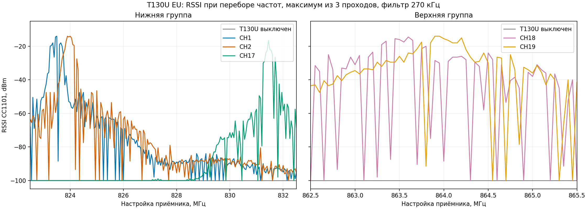
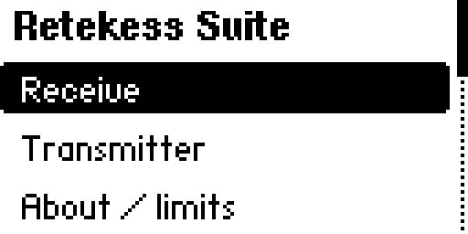
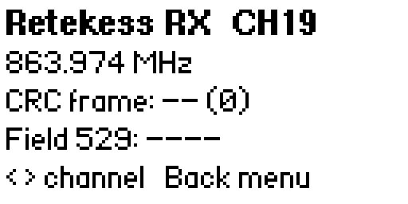

# Исследование Retekess T130U / T131U для Flipper Zero

Независимое исследование одного европейского комплекта T130U/T131U. Здесь опубликованы приложение Flipper Zero, исходники экспериментов, измерения и схемы. **Записи с голосом владельца и архивы сырых захватов исключены из публичной версии.** [English](README.md).

## Установлено опытами

- Рабочий приёмный профиль Flipper: около 250 кбит/с GFSK. Измеренные центры: CH1 823,475 МГц, CH17 831,475, CH18 863,475, CH19 863,975; служебная полоса CHS 864,475 МГц.
- В наблюдаемом кадре: 32-битный маркер канала, один постоянный бит, 62 байта G.711 A-law, 16-битное служебное поле и CRC-16/AUG-CCITT по битам 33–544. [Схема](figures/frame_structure.svg) · [описание протокола](docs/PROTOCOL.md).
- На собственном T131U ранее проверены цели CHS CH1 `0x1101`, CH18 `0x1112`, CH19 `0x1113`, команда All Off `0x7777` и короткий звук CH19.
- Поля согласуются с формулой `0x1100 | номер канала`. Приложение предлагает все CH1–CH19, но **CH2–CH17 остаются гипотезой**. В публичной сборке команды создаются заново с цифровой тишиной вместо фрагментов личных записей; эти новые кадры ещё нужно проверить на приёмнике.

## Приложение Flipper

Скачайте [Retekess Suite `.fap`](bin/retekess_suite.fap) либо соберите [`app/`](app/) через `ufbt` с API 87.1. Скопируйте файл в `/ext/apps/Sub-GHz/`. Сборка рассчитана на Momentum `mntm-012`; перепрошивка не нужна.

- **Receive**: монитор CRC для CH1, CH17–CH19 или CHS, журнал событий CSV, короткий сырой захват с извлечением A-law, экспериментальное воспроизведение через динамик.
- **Transmitter**: выбор цели CH1–CH19, All Off, подготовленный звуковой файл CH19. Проверенные ранее цели помечены *known*, остальные — *test*.
- Файлы сохраняются в `/ext/retekess_probe/` на Flipper.

Сборка, меню и контрольная запись на Flipper проверены. **Новые кадры с цифровой тишиной**, расширенный выбор каналов и качество динамика ещё не проверены на T131U. Указанные выше успешные радиоопыты использовали прежние закрытые захваты. Чтобы создать звуковой `.bin` без захваченного шаблона: `python3 research/retekess_audio_encoder.py input.wav --output custom_alaw_radio.bin` (нужен `ffmpeg`). В приложении выбирайте именно подготовленный `.bin`, не WAV.

 

## Исходники и ограничения

В [`research/`](research/) находятся исходники опытов и скрипты обработки. Заголовки с полезной нагрузкой и сырые захваты удалены ради приватности; для сборки некоторых исторических проб потребуются новые собственные захваты. Объединённое приложение в `app/` самодостаточно. Протокол **не декодирован полностью**: неизвестны pairing/ID группы, все физические параметры каналов, точные эфирные границы пакета, передача длинного трека и возможные отдельные команды MIC/AUX/Bluetooth. Результаты относятся к одному EU-комплекту.

Передавайте сигнал только на своём оборудовании и в разрешённых условиях. Проект не связан с Retekess или Flipper Devices. Код и документация — MIT.
